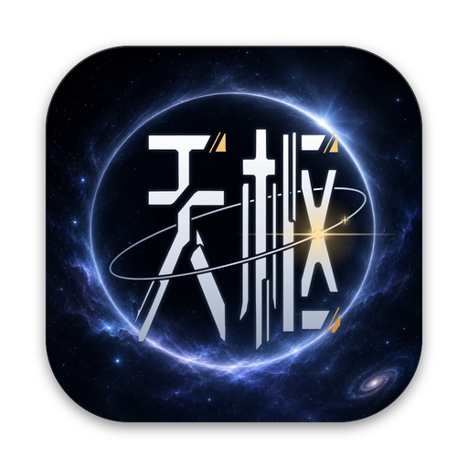
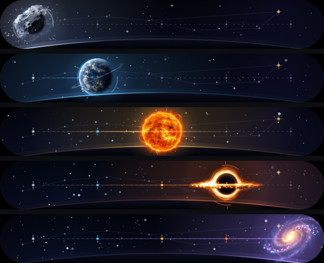

<p align="center">
  
</p>

<h1 align="center">天枢 Tianshu</h1>

<p align="center">
  本机的多 agent 工作台：各家 coding agent 在一个入口里用，会话仍然归它们自己。<br/>
  A local workbench for many coding agents — one place to drive them, while every session stays native.
</p>

<p align="center">
  
  
  
</p>

天枢是北斗第一星，居中调度。它把 Claude Code、Codex、ZCode、Antigravity、Grok、DeepSeek Harness、fastctx 等 agent 放进同一个窗口：开会话、切模型和思考强度、看各家套餐的剩余额度、让一个会话派生子会话给另一个 agent 去做。

天枢只是外壳。每个 agent 都跑它自己的原生程序，发出去的请求和它的官方 app 一样；会话照样出现在各家原生 app 的会话列表里。

> 这是个人项目，目前只在 macOS（Apple Silicon）上日常使用和测试。

## 特点

- **原生 harness，纯外壳**：Claude 走 Claude Code CLI，ZCode 走 `zcode-acp-server`，Antigravity 和 DeepSeek Harness 通过各自 app 的本地服务接入（见 `bridges/`），不另造一套请求。
- **会话归原生**：会话正本在各 agent 自己的存储里，天枢只记索引和父子关系；在原生 app 里也能接着用。
- **子会话**：一个会话可以把子任务派给任意 agent（比如 Claude 派给 ZCode），子会话完成后带着它的回复自动唤醒父会话；新建子会话时按「剩余额度多、离重置近」推荐 agent。
- **套餐额度**：顶栏和用量页显示各 agent 的剩余额度与重置时间（ZCode Coding Plan、Antigravity、Grok、fastctx 等）。
- **原生程序守护**：某个 agent 依赖的原生 app 没开时，提示并可一键在后台启动。
- **思考强度滑块**：档位随模型变化，从小行星、行星、恒星、黑洞到星系，拖动有粒子拖尾，升档有冲击波。
- **中文优先**：界面默认中文。
- **不上报**：不向任何第三方发送使用数据，没有自动更新源。

<p align="center">
  
</p>

## 目录

| 路径 | 内容 |
| --- | --- |
| `apps/server` | 服务端：会话编排、各 agent 驱动、额度读取、子会话 |
| `apps/web` | 界面 |
| `apps/desktop` | Electron 外壳（产品名 Tianshu，数据在 `~/.tianshu`） |
| `packages/provider-acp-registry` | ACP agent 的接入、模型与档位探测、额度 |
| `bridges/antigravity-acp` | 把 Antigravity 包成 ACP agent（走 Antigravity app 自己的本地服务） |
| `bridges/dsh-acp` | 把 DeepSeek Harness 包成 ACP agent（独立的无界面 profile） |
| `assets/tianshu` | 字标、图标与天体素材的源文件 |

fastctx 的 ACP 桥不在本仓库，随 fastctx-web 提供。

## 开发与打包

需要 Vite+ 的命令行 `vp`（它会管理 Node 和 pnpm）和 Rust 工具链。

```bash
vp install
vp run dev --home-dir "$PWD/.t3"      # 开发版，数据隔离在 .t3
vp run dist:desktop:dmg:arm64         # 打包 macOS（Apple Silicon），产物在 release/
```

改了界面文案后，中文译文要按哈希写进 `apps/web/src/i18n/translations/zh.json`，否则打包版会显示英文。

各 agent 需要各自装好并登录（Claude Code、Codex、ZCode、Antigravity、Grok CLI、DeepSeek Harness 等）；在「设置 → 智能体提供方」里添加实例。

## 说明

- 天枢与 T3、Anthropic、OpenAI、Google、智谱、xAI、DeepSeek 等均无隶属关系。各 agent 的使用受其自身条款约束。
- `bridges/` 里的桥接调用的是对应 app 在本机开放的接口，这些接口不是公开 API，随对方版本更新可能失效。

## 致谢

- **[T3 Code](https://github.com/pingdotgg/t3code)**（pingdotgg，MIT）：天枢的底座——服务端、会话编排与各 agent 的驱动框架都来自它。
- **[T3 星尘版](https://github.com/zds-xiaoxin/xiaoxin-t3code)**（小新，MIT）：天枢最初就是在星尘版上动手的，它的界面、中文化和大量体验改进至今都在天枢里。谢谢小新。

## 许可

[MIT](LICENSE)，保留 T3 Code 原有的版权与许可声明。

---

## English

Tianshu (天枢, the first star of the Big Dipper) is a desktop workbench for running many coding agents side by side — Claude Code, Codex, ZCode, Antigravity, Grok, DeepSeek Harness, fastctx and more. It is only a shell: each agent runs its own native harness and sends the same requests its official app would, and sessions stay in each agent's own store, so they show up in the native apps too.

Highlights: cross-agent sub-sessions that wake the parent with the child's reply, plan quota for each agent in the top bar, one-click start of an agent's native app, a per-model reasoning-effort slider, Chinese UI by default, and no telemetry.

Tianshu is built on [T3 Code](https://github.com/pingdotgg/t3code) (MIT) and started from xiaoxin's [T3 Stardust](https://github.com/zds-xiaoxin/xiaoxin-t3code) community edition, whose UI and polish it still carries — thank you both. It is a personal project, used and tested on Apple Silicon macOS, and not affiliated with any of the agent vendors.
